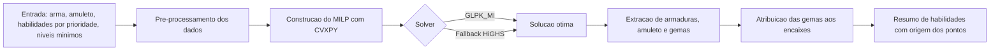

# MH Wilds Build Optimizer

Otimizador de builds para **Monster Hunter Wilds** baseado em **Programação Linear Inteira Mista (MILP)**. Dada uma arma, um amuleto opcional e uma lista de habilidades em ordem de prioridade, o sistema seleciona a combinação ótima de armaduras, amuleto e gemas, respeitando os encaixes disponíveis e os níveis máximos de cada habilidade.

**Aplicação online:** [mhwilds.lpaulino.com](https://mhwilds.lpaulino.com/)

---

## Sumário

1. [Visão geral](#visão-geral)
2. [Funcionalidades](#funcionalidades)
3. [Arquitetura do pipeline](#arquitetura-do-pipeline)
4. [Formulação matemática](#formulação-matemática)
5. [Pós-processamento](#pós-processamento)
6. [Instalação e uso](#instalação-e-uso)
7. [Formato dos dados](#formato-dos-dados)
8. [Hipóteses e limitações](#hipóteses-e-limitações)
9. [Extensões possíveis](#extensões-possíveis)

---

## Visão geral

Montar uma build em Monster Hunter Wilds é um problema combinatório. Cada uma das cinco peças de armadura (cabeça, peito, braços, cintura e pernas) possui dezenas de opções, cada peça tem encaixes de tamanhos distintos, e as gemas competem por esses encaixes. Avaliar todas as combinações por força bruta é inviável, e heurísticas gulosas não oferecem garantia de otimalidade.

Este projeto modela o problema como um MILP e o resolve com um solver exato. O resultado é uma build **comprovadamente ótima** segundo a hierarquia de prioridades informada pelo usuário.

O núcleo do projeto está em `optimizer.py`, na classe `BuildOptimizer`.

## Funcionalidades

- Otimização exata com garantia de otimalidade, via branch and bound.
- Priorização lexicográfica das habilidades: a primeira habilidade da lista sempre prevalece sobre as seguintes.
- Níveis mínimos opcionais por habilidade, tratados como restrições rígidas.
- Amuleto fixo ou escolhido automaticamente pelo otimizador.
- Controle de encaixes por tamanho, com distinção entre encaixes de arma e de armadura.
- Penalização de pontos excedentes acima do nível máximo, evitando desperdício de gemas.
- Rastreabilidade completa: cada ponto de habilidade da resposta informa sua origem (arma, armadura, amuleto ou gema).
- Atribuição concreta das gemas aos encaixes de cada peça.
- Solver principal GLPK com fallback automático para HiGHS.

## Arquitetura do pipeline



O fluxo de uma chamada a `optimize` é:

1. **Pré-processamento** (executado uma única vez no construtor): filtra armaduras de alto rank, indexa armas e amuletos por ID, converte listas de habilidades em dicionários `{skill_id: nível}` e separa as gemas em gemas de arma e de armadura. Para cada amuleto, apenas o rank mais alto é considerado.
2. **Construção do modelo**: cria as variáveis de decisão, as restrições e a função objetivo.
3. **Resolução**: tenta o `GLPK_MI` e recorre ao `HiGHS` caso o primeiro não esteja disponível ou falhe.
4. **Validação**: aceita os status `optimal` e `optimal_inaccurate`. Em qualquer outro caso, lança `RuntimeError` sugerindo a redução dos níveis mínimos.
5. **Pós-processamento**: converte a solução numérica em uma build legível.

## Formulação matemática

### Conjuntos e parâmetros

| Símbolo | Descrição |
|---|---|
| $\mathcal{S}$ | Conjunto de habilidades |
| $L_s$ | Nível máximo da habilidade $s$ |
| $\mathcal{K}$ | Tipos de peça: cabeça, peito, braços, cintura e pernas |
| $\mathcal{A}_k$ | Peças de armadura de alto rank do tipo $k \in \mathcal{K}$ |
| $\mathcal{A}$ | União de todos os $\mathcal{A}_k$ |
| $\mathcal{C}$ | Amuletos disponíveis |
| $\mathcal{D}^W$, $\mathcal{D}^A$ | Gemas de arma e gemas de armadura |
| $T = (t_1, \dots, t_n)$ | Habilidades alvo, em ordem decrescente de prioridade |
| $m_s$ | Nível mínimo exigido para $s$ (opcional) |
| $\ell^{W}_s$ | Nível de $s$ fornecido nativamente pela arma escolhida |
| $\ell^{A}_{a,s}$ | Nível de $s$ fornecido pela peça $a$ |
| $\ell^{C}_{c,s}$ | Nível de $s$ fornecido pelo amuleto $c$ |
| $\ell^{D}_{d,s}$ | Nível de $s$ fornecido pela gema $d$ |
| $\kappa_d \in \{1,2,3\}$ | Tamanho da gema $d$ |
| $\mathrm{cap}^{W}_{\lambda}$ | Número de encaixes da arma com tamanho maior ou igual a $\lambda$ |
| $\mathrm{cap}_{\lambda}(a)$ | Número de encaixes da peça $a$ com tamanho maior ou igual a $\lambda$ |
| $\sigma_a$ | Soma dos tamanhos de todos os encaixes da peça $a$ |

A arma é um **dado de entrada**, e não uma variável de decisão. Seus encaixes e suas habilidades nativas entram no modelo como constantes.

### Variáveis de decisão

| Variável | Domínio | Significado |
|---|---|---|
| $x_a$ | $\{0,1\}$ | 1 se a peça $a \in \mathcal{A}$ é escolhida |
| $y_c$ | $\{0,1\}$ | 1 se o amuleto $c \in \mathcal{C}$ é escolhido |
| $u_d$ | $\mathbb{Z}_{\ge 0}$ | Quantidade de gemas $d \in \mathcal{D}^W$ engastadas na arma |
| $v_d$ | $\mathbb{Z}_{\ge 0}$ | Quantidade de gemas $d \in \mathcal{D}^A$ engastadas nas armaduras |
| $e_s$ | $[0, L_s]$ | Nível efetivo da habilidade $s$ (contínua) |
| $o_s$ | $\mathbb{R}_{\ge 0}$ | Excedente de pontos acima de $L_s$ (contínua) |

Apesar de $e_s$ e $o_s$ serem contínuas, todos os coeficientes do modelo são inteiros e os limites são inteiros, o que mantém os valores ótimos inteiros nos casos relevantes. A extração da solução arredonda os valores por segurança numérica.

### Nível bruto de habilidade

O nível bruto $r_s$ é a soma de todas as contribuições para a habilidade $s$. Ele é uma expressão linear nas variáveis de decisão:

$$
r_s = \ell^{W}_s + \sum_{a \in \mathcal{A}} \ell^{A}_{a,s}\, x_a + \sum_{c \in \mathcal{C}} \ell^{C}_{c,s}\, y_c + \sum_{d \in \mathcal{D}^W} \ell^{D}_{d,s}\, u_d + \sum_{d \in \mathcal{D}^A} \ell^{D}_{d,s}\, v_d
$$

### Restrições

**C1. Uma peça por tipo de armadura**

$$
\sum_{a \in \mathcal{A}_k} x_a = 1 \qquad \forall\, k \in \mathcal{K}
$$

**C2. Amuleto**

Quando o usuário não fixa um amuleto, no máximo um é escolhido:

$$
\sum_{c \in \mathcal{C}} y_c \le 1
$$

Quando o usuário fixa o amuleto $c^\ast$, o modelo impõe $y_{c^\ast} = 1$ e $y_c = 0$ para todo $c \neq c^\ast$.

**C3. Capacidade de encaixes da arma**

$$
\sum_{\substack{d \in \mathcal{D}^W \\ \kappa_d \ge \lambda}} u_d \le \mathrm{cap}^{W}_{\lambda} \qquad \forall\, \lambda \in \{1,2,3\}
$$

**C4. Capacidade de encaixes das armaduras**

$$
\sum_{\substack{d \in \mathcal{D}^A \\ \kappa_d \ge \lambda}} v_d \le \sum_{a \in \mathcal{A}} \mathrm{cap}_{\lambda}(a)\, x_a \qquad \forall\, \lambda \in \{1,2,3\}
$$

As restrições C3 e C4 formam uma família de desigualdades **aninhadas por tamanho**. Uma gema de tamanho $\kappa$ só pode ocupar encaixes de tamanho maior ou igual a $\kappa$, o que cria uma relação de compatibilidade em cadeia. Nesse tipo de estrutura, a condição de Hall se reduz exatamente aos três limiares $\lambda \in \{1,2,3\}$. Portanto, as desigualdades são **necessárias e suficientes** para que exista uma atribuição viável das gemas aos encaixes, sem a necessidade de variáveis binárias de atribuição gema por encaixe. Isso mantém o modelo compacto.

Como as gemas de armadura não possuem restrição por peça, os encaixes das cinco peças escolhidas são tratados como um único conjunto agregado.

**C5. Nível efetivo e teto da habilidade**

$$
0 \le e_s \le L_s \qquad\qquad e_s \le r_s \qquad\qquad \forall\, s \in \mathcal{S}
$$

Juntas, essas restrições representam $e_s \le \min(r_s, L_s)$. Como a função $\min$ é côncava e o objetivo maximiza $e_s$ com peso positivo, essa linearização é exata e dispensa variáveis binárias adicionais.

**C6. Nível mínimo exigido pelo usuário**

Para cada habilidade com mínimo definido e positivo:

$$
e_s \ge \min(m_s, L_s)
$$

O mínimo é limitado ao nível máximo da habilidade para evitar inviabilidade trivial. Combinada com C5, essa restrição força $r_s \ge \min(m_s, L_s)$. Se nenhuma build satisfizer todos os mínimos simultaneamente, o solver retorna inviabilidade e a aplicação lança um `RuntimeError` explicativo.

**C7. Excedente de pontos**

$$
o_s \ge r_s - L_s \qquad\qquad o_s \ge 0 \qquad\qquad \forall\, s \in \mathcal{S}
$$

Como $o_s$ é penalizado na função objetivo, ele assume o valor $\max(0,\, r_s - L_s)$ no ótimo.

### Função objetivo

$$
\max \;\; \underbrace{\sum_{i=1}^{n} 8^{\,n-i}\, e_{t_i}}_{\text{(I) prioridades}} \;+\; \underbrace{0{,}01 \sum_{t \in T} \sum_{a \in \mathcal{A}} \ell^{A}_{a,t}\, x_a}_{\text{(II) habilidades nativas}} \;+\; \underbrace{0{,}001 \Big( \sum_{a \in \mathcal{A}} \sigma_a\, x_a - \sum_{d \in \mathcal{D}^A} \kappa_d\, v_d \Big)}_{\text{(III) encaixes livres}} \;-\; \underbrace{0{,}005 \sum_{s \in \mathcal{S}} o_s}_{\text{(IV) excedente}}
$$

| Termo | Peso | Papel |
|---|---|---|
| (I) Prioridades | $8^{n-i}$ por nível | Objetivo principal. Impõe a ordem de prioridade informada |
| (II) Nativas | 0,01 por nível | Desempate. Prefere peças que já trazem a habilidade alvo, poupando encaixes |
| (III) Encaixes livres | 0,001 por unidade de tamanho | Desempate. Prefere builds que deixam encaixes de armadura sobrando |
| (IV) Excedente | 0,005 por ponto | Penalidade. Evita gastar recursos em pontos acima do nível máximo |

### Por que a base 8

O termo (I) implementa uma **otimização lexicográfica aproximada por escalarização**. Com $n$ habilidades alvo, a habilidade de prioridade $i$ recebe peso $8^{n-i}$. Assumindo nível máximo de até 7 (valor padrão adotado no código para habilidades sem teto definido), o ganho máximo possível em todas as habilidades de prioridade inferior a $i$ é:

$$
7 \sum_{j=i+1}^{n} 8^{\,n-j} = 7 \cdot \frac{8^{\,n-i} - 1}{7} = 8^{\,n-i} - 1 < 8^{\,n-i}
$$

Ou seja, **um único nível adicional em uma habilidade de prioridade $i$ vale mais do que qualquer combinação de ganhos nas habilidades menos prioritárias**. Esse é o comportamento lexicográfico desejado, obtido com uma única passada do solver, sem resolver $n$ problemas sequenciais.

Para três habilidades alvo, por exemplo, os pesos são 64, 8 e 1.

Os termos (II), (III) e (IV) usam coeficientes ordens de grandeza menores que o peso de um nível da habilidade menos prioritária. Eles atuam apenas como critérios de desempate e não competem com o objetivo principal.

### Papel de cada termo secundário

- **Nativas (II):** duas builds podem atingir o mesmo nível via gemas ou via peças. A preferência por peças nativas libera encaixes, o que torna a build mais flexível.
- **Encaixes livres (III):** o termo mede a capacidade total de encaixes das peças escolhidas menos o tamanho das gemas de armadura usadas. É uma proxy para folga de encaixes e também desestimula o uso de gemas sem benefício.
- **Excedente (IV):** sem essa penalidade, gemas que apenas geram pontos acima do teto seriam neutras para o objetivo, e o solver poderia usá-las sem necessidade. A penalidade é aplicada a todas as habilidades, não apenas às alvo.

### Natureza do problema

Todas as expressões são lineares, com variáveis binárias, inteiras e contínuas, o que caracteriza um MILP. O problema generaliza variantes do problema da mochila multidimensional e é NP-difícil em geral. Na prática, a estrutura do modelo (apenas cinco restrições de atribuição, capacidades aninhadas e coeficientes pequenos) é favorável ao branch and bound, e as instâncias são resolvidas rapidamente.

## Pós-processamento

Após a resolução, o solver informa **quantas** gemas de cada tipo usar, mas não **onde** colocá-las. A atribuição concreta é feita por um algoritmo *best fit decreasing*:

1. As gemas são ordenadas por tamanho, da maior para a menor.
2. Cada gema é colocada no **menor encaixe livre** que a comporte.
3. Para armaduras, os encaixes das cinco peças formam um único conjunto de candidatos.

Graças à estrutura aninhada das restrições C3 e C4, esse procedimento sempre encontra uma atribuição viável quando o solver retorna uma solução. Ele também preserva os encaixes maiores para as gemas que realmente precisam deles.

Em seguida, o sistema monta o resumo de habilidades, que contém:

- nível efetivo, nível bruto, nível máximo e excedente;
- nível mínimo exigido, quando definido;
- indicação de habilidade alvo, com sua posição de prioridade;
- lista de origens dos pontos (arma, armadura, amuleto ou gema), com o nível de cada contribuição.

As habilidades são ordenadas por: alvo atingida, alvo não atingida, extra obtida. Dentro de cada grupo, vale a prioridade informada, depois o nível e por fim o nome.

## Instalação e uso

### Requisitos

- Python 3.9 ou superior
- [CVXPY](https://www.cvxpy.org/)
- Um solver MILP: GLPK (via `cvxopt`) e, como alternativa, HiGHS (via `highspy`)

```bash
git clone https://github.com/<usuario>/<repositorio>.git
cd <repositorio>
pip install cvxpy cvxopt highspy numpy
```

### Exemplo

```python
from optimizer import BuildOptimizer

optimizer = BuildOptimizer(
    skills=skills,
    armor=armor,
    weapons=weapons,
    charms=charms,
    decorations=decorations,
)

build = optimizer.optimize(
    target_skills=[12, 7, 31],   # ordem da lista define a prioridade
    weapon_id=101,
    charm_id=None,               # None deixa o otimizador escolher o amuleto
    min_levels={12: 4},          # exige pelo menos nível 4 na habilidade 12
)

print(build["status"])
for name, info in build["skills"].items():
    print(name, info["level"], "/", info["max_level"])
```

### API

```python
BuildOptimizer(skills, armor, weapons, charms, decorations)
```

| Parâmetro | Tipo | Descrição |
|---|---|---|
| `skills` | `list[dict]` | Catálogo de habilidades |
| `armor` | `list[dict]` | Catálogo de armaduras. Apenas as de rank `high` são usadas |
| `weapons` | `list[dict]` ou `dict` | Catálogo de armas, indexado por ID |
| `charms` | `list[dict]` ou `dict` | Catálogo de amuletos, indexado por ID |
| `decorations` | `list[dict]` | Catálogo de gemas |

```python
optimizer.optimize(target_skills, weapon_id, charm_id=None, min_levels=None)
```

| Parâmetro | Tipo | Descrição |
|---|---|---|
| `target_skills` | `list[int]` | IDs das habilidades alvo, da mais para a menos prioritária |
| `weapon_id` | `int` | ID da arma base |
| `charm_id` | `int` ou `None` | Amuleto fixo, ou `None` para escolha automática |
| `min_levels` | `dict[int, int]` ou `None` | Nível mínimo exigido por habilidade |

**Exceções:** `ValueError` para arma ou amuleto inexistente. `RuntimeError` quando o modelo é inviável com os mínimos informados.

## Formato dos dados

Os catálogos de entrada seguem a estrutura abaixo. Apenas os campos usados pelo otimizador estão listados.

```jsonc
// skills
{ "id": 1, "name": "Attack Boost", "icon": { "kind": "damage" }, "ranks": [{ "level": 1 }, { "level": 5 }] }

// armor
{ "id": 10, "name": "Peça X", "kind": "head", "rank": "high",
  "slots": [3, 1], "skills": [{ "level": 2, "skill": { "id": 1 } }] }

// weapons
{ "id": 101, "name": "Arma Y", "kind": "great-sword",
  "slots": [2, 1], "skills": [{ "level": 1, "skill": { "id": 7 } }] }

// charms (apenas o rank de maior nível é usado)
{ "id": 5, "ranks": [{ "level": 3, "name": "Amuleto Z", "slots": [], "skills": [...] }] }

// decorations
{ "id": 200, "name": "Gema W", "kind": "armor", "slot": 2,
  "skills": [{ "level": 1, "skill": { "id": 1 } }] }
```

O valor de `kind` das armaduras deve ser um entre `head`, `chest`, `arms`, `waist` e `legs`. O das gemas deve ser `weapon` ou `armor`.

### Formato da resposta

```jsonc
{
  "status": "optimal",
  "weapon": { "id": 101, "name": "...", "kind": "...", "slots": [{ "slot_size": 2, "decoration": { "id": 200, "name": "...", "slot": 2 } }], "skills": [] },
  "armor": [ { "id": 10, "name": "...", "kind": "head", "slots": [], "skills": [] } ],
  "charm": { "id": 5, "name": "...", "skills": [] },
  "skills": {
    "Attack Boost": {
      "id": 1,
      "level": 5,
      "raw_level": 6,
      "max_level": 5,
      "overflow": 1,
      "min_required": null,
      "icon_kind": "damage",
      "is_target": true,
      "priority": 1,
      "status_type": "target_acquired",   // target_acquired | target_unacquired | extra_acquired
      "sources": [
        { "source": "Cabeça: Peça X", "level": 2, "type": "armor_native" }
      ]
    }
  }
}
```

Os tipos de origem em `sources` são `weapon_native`, `armor_native`, `charm_native` e `decoration`.

## Hipóteses e limitações

O modelo adota as seguintes hipóteses simplificadoras:

- **Arma fixa.** A arma é escolhida pelo usuário e não faz parte da otimização.
- **Apenas alto rank.** Armaduras de outros ranks são descartadas.
- **Amuleto no rank máximo.** Cada amuleto é considerado apenas em seu rank de maior nível.
- **Estoque ilimitado de gemas.** Não há limite de quantidade por tipo de gema, nem controle de gemas que o jogador já possui.
- **Encaixes de tamanho 1 a 3.** As restrições C3 e C4 cobrem esses três tamanhos.
- **Sem bônus de conjunto ou de grupo.** Apenas as habilidades listadas diretamente em cada item são contabilizadas.
- **Teto padrão 7.** Habilidades sem nível máximo definido assumem o teto 7, o que também sustenta a garantia lexicográfica dos pesos.

## Extensões possíveis

- Limitar a quantidade de cada gema conforme o inventário do jogador.
- Incluir bônus de conjunto e de grupo como restrições condicionais, usando variáveis binárias de ativação.
- Tornar a arma uma variável de decisão.
- Gerar múltiplas soluções ótimas ou quase ótimas, para comparação entre builds.
- Permitir excluir peças específicas da busca.
